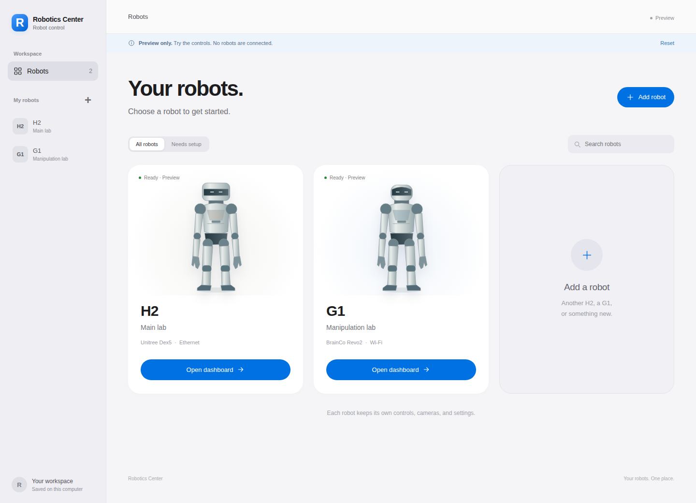
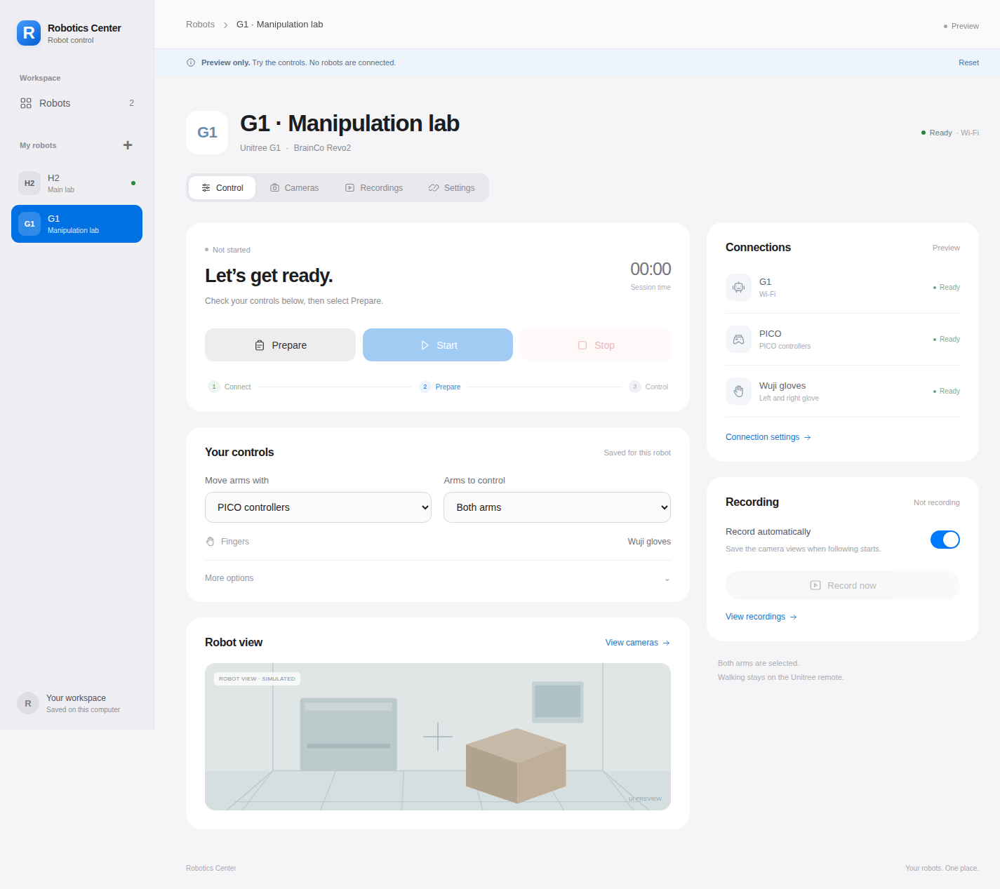

# Shared robot dashboard preview

A separate UI review for selecting H2, G1 and additional robot profiles.
This branch includes both existing robot integrations and an independent
static preview. The preview does not import either controller, contact an
agent, open an SDK or send robot commands. Its page policy blocks fetch and
WebSocket connections.

The layout uses system fonts, a quiet sidebar, larger rounded cards and a single
blue accent. Robot selection leads to four clear pages: Control, Cameras,
Recordings and Settings. The session flow is Connect → Prepare → Start, with
Stop available while the preview session is active.





From the repository root:

```bash
python3 dashboard/serve.py
```

Open http://127.0.0.1:8790/. To review from another device on the same network:

```bash
python3 dashboard/serve.py --bind 0.0.0.0 --port 8790
```

The preview includes robot selection, per-robot session controls, cameras,
recordings, setup and browser-local robot profiles. All connections, camera
scenes, recording rows and session transitions are simulated. Reset preview
restores the two example robots. No credentials or personal calibration data
are included.

## Existing robot implementations

- [H2 integration](../integrations/h2/README.md): Dex5 hands, browser/native
  PICO input, Wuji gloves, head following, cameras and recording.
- [G1 integration](../integrations/g1/README.md): PICO controllers/wrist
  trackers, per-arm selection, Wuji calibration and BrainCo Revo2 hands.

G1 was imported from `RoboticsCenter/xr_teleoperate` branch
`g1/pico-wuji-dashboard`, commit `50e8e07e93f6360197efca81fbd4e21c4339f477`.
H2 is based on local reviewed revision `47a08b9`. Their runtime paths,
dependencies and hardware validation remain specific to each integration.
The shared preview does not replace their live dashboards.

Only preview profiles/settings are stored in browser localStorage. Personal
models, machine configuration, SDKs, robot logs and recordings remain outside
this UI source.

See [browser checks](checks/README.md) for the isolated preview checks and
screenshot capture. These checks establish UI behavior, not hardware readiness.
